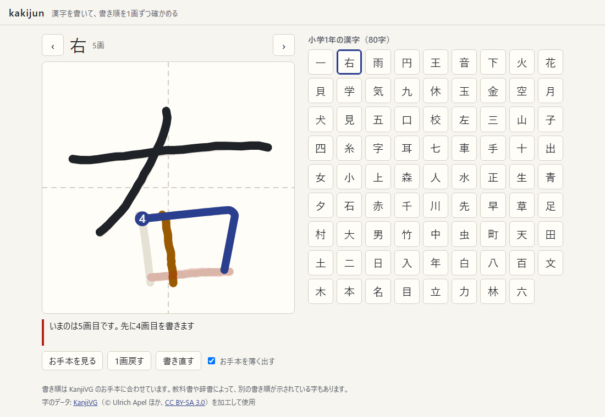
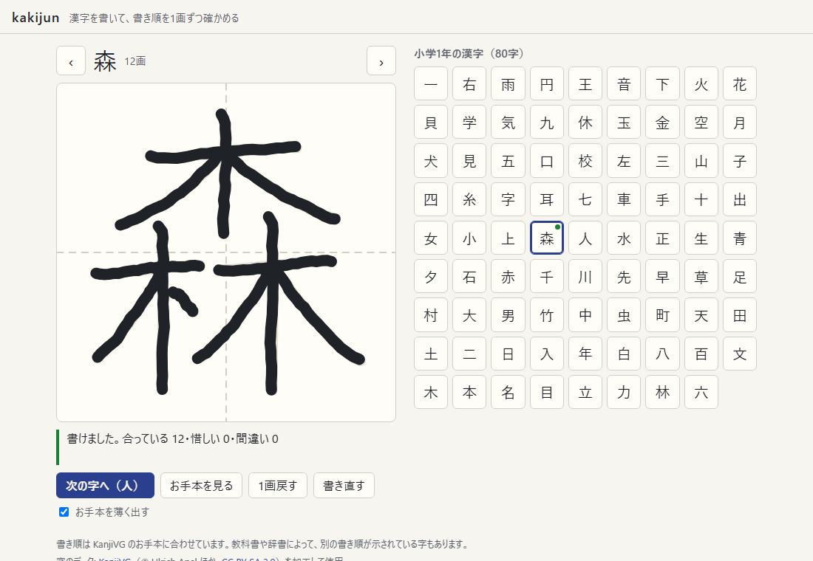
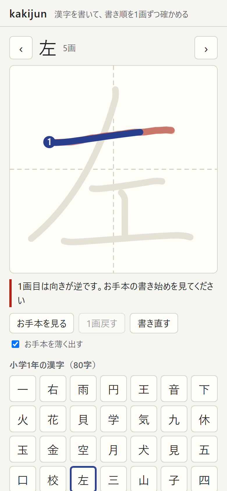

# kakijun

漢字を指・ペン・マウスで書くと、1画ごとに書き順・向き・形を確かめて返す。小学1年の80字に対応している。
間違えた画は、その場で本来の画のお手本が書き始めから伸びていく動きで示す。

**アプリ:** 公開準備中



字のデータは [KanjiVG](https://kanjivg.tagaini.net) を使い、判定は端末の中で行う。
公開版は Content Security Policy で通信（fetch など）をすべて禁じている。

## できること

| 書き終えたところ | スマホで向きを間違えたとき |
|---|---|
|  |  |

- **1画ずつ判定する**: 書いた線を、次に書くはずの画と比べて「合っています」「惜しい（ずれ・長さ・形の指摘）」「向きが逆」「いまのは○画目です」「合いません」のどれかを返す
- **間違えたらお手本が動く**: 受け取らなかった線を赤く出して薄れさせ、その上に本来の画を書き始めの位置から伸ばして見せる
- **字全体のずれは責めない**: 字全体が小さい・少しずれている、というだけで毎画「ずれています」とは言わない（下の「字全体の補正」）
- **お手本を見る**: 全部の画を番号付きで順に描く。お手本を薄く出すかどうかは切り替えられる
- **1画戻す・書き直す**: 戻した画は合格の数から引き、間違えた回数は残す
- **右と左**: 最初に出す字は「右」。右は「ノ」から、左は横画から書くので、書き順の確かめが伝わりやすい
- **スマホ・タブレット**: 書いているあいだは画面がスクロールしない。ペンで書いたあとの指の接触は手のひらとみなして無視する。一覧から字を選ぶと書く欄まで戻る

## 作りの要点

### データ: KanjiVG

KanjiVG は、字ごとに画の中心線を SVG の path で持ち、書き順の番号と画の種類（㇐・㇑・㇒ など）が付いている。座標は 109×109 の枠。
リリース r20260714 の XML（3.6MB）から、学年別漢字配当表の1年の80字（計400画）を抜き出して `src/kanji/data/grade1.json`（42KB、gzip 16KB）にした。

- 80字の画数を、KanjiVG とは別に書き起こした表（[`src/kanji/grades.ts`](src/kanji/grades.ts)）と突き合わせ、すべて一致した（`check:data`）
- path の命令は M・C・S（大文字・小文字）だけ。3次ベジェを折れ線にして使う（[`src/kanji/path.ts`](src/kanji/path.ts)）
- **はね・とめ・はらいは判定しない。** KanjiVG は中心線だけで、「ここははねる」という情報を持っていないため
- 字のデータは JS の別ファイルとしてビルドされ、動的 import で読む。アプリと同じ場所から読むので、CSP の `script-src 'self'` の範囲に収まる

### 判定: 32点に打ち直して比べる

[`src/kanji/judge.ts`](src/kanji/judge.ts)。書いた線と手本の画を、どちらも道のりで等間隔な32点に打ち直し、i 番目の点どうしの距離の平均で比べる。

| 判定 | 条件（距離は 109 の枠での値） |
|---|---|
| 合っている | 次の画との距離が 10 以下（枠の約1割） |
| いまのは○画目です | 次の画に合わず、まだ書いていない別の画との距離が 10 以下 |
| 向きが逆 | 書いた線を逆からたどると、次の画との距離が 18 以下で、順にたどるより近い |
| 惜しい | 次の画との距離が 18 以下（枠の約1.6割）。位置・長さ・形のどれがずれたかを添える |
| 合いません | どれにも当たらない |

- 長さ 15 未満の画（点）は向きと長さを問わない。手で書く点は短く、向きが安定しないため
- **書き順違いは向きより先に見る。** 竹の1画目（ノ）の代わりに2画目（横）を書くと、横はノを逆にたどった線にも近くなり、最初は「向きが逆」と出ていた
- **惜しい程度に合う画は、ほかの画のほうが明らかに（距離が半分未満）合うときだけ書き順違いにする。** 少し位置がずれた1画目が、近くの似た画（林の1画目の横と、右の木の横など）と取り違えられていたため

### 字全体の補正

人は枠いっぱいに字を書くとは限らない。書き終えた画から字全体の位置と大きさ（0.7〜1.4倍）を最小二乗で推定し、次の画はそれを差し引いてから比べる。
推定は書いた画が少ないうちは当てにならないので、n 画書いたら n/(n+1) の重みでだけ補正する。回転は見ない（1画目が少し傾くだけで大きく効いてしまうため）。

手本を崩した入力（字全体のずれ・大きさ・傾き、画ごとのずれ・長さ、線の揺れ）を3段階の強さで作り、80字を5回ずつ書かせて比べた。

| 崩し方 | 補正なし | 補正あり |
|---|---|---|
| 丁寧（全体 ±4・±8%・±2°、画ごと ±2・長さ ±10%） | 合っている 99.8%・惜しい 0.2% | 同じ |
| ふつう（全体 ±8・±15%・±4°、画ごと ±4・長さ ±20%） | 合っている 72.2%・惜しい 27.2%・合いません 0.5% | 合っている 88.1%・惜しい 11.7%・合いません 0.2% |
| 雑（全体 ±12・±22%・±6°、画ごと ±6・長さ ±30%） | 合っている 36.0%・惜しい 47.0%・合いません 15.4% | 合っている 61.7%・惜しい 33.2%・合いません 5.1% |

**1画目は比べる基準がないので、字全体を大きく外すと判定できない。** 0.8倍に縮めて右下に8ずらすと、80字のうち12字の1画目が外れた（7字は合いません、5字は近くの別の画と取り違えて書き順違い）。お手本を薄く出していれば起きにくいが、お手本を消して書くときは起きうる。

## 確かめ方

| コマンド | 確かめること |
|---|---|
| `npm run check:data` | 80字がそろっていて、画数が別の表と一致し、枠からはみ出さない |
| `npm run check:judge` | 400画すべてで、手本をなぞる→合格、揺らす→受け取る、小さく右下に書く→2画目からは合格、逆向き→向き違い（判定できる292画）、右に12ずらす→惜しい、次の画を飛ばす→書き順違い（区別できる282組） |
| `npm run e2e` | 公開と同じビルドを画面なしの Chrome で開き、本物のマウス・タッチ・ペンの入力で書く（10件）。書き順違いのときにお手本が動いて消えること、書いているあいだに画面が動かないこと、ペンのあとの指を無視すること、CSP で通信が止まることも見る |

e2e で、指を離して0.1秒ほどで次のタップをすると Chrome が click にしないことがわかった（1秒空けると届く）。人の操作ではまず起きない間合いなので、テストのほうで待つようにした。

## 扱っていないこと

- はね・とめ・はらい（上に書いたとおり、データにない）
- 小学2年以上の字。データは学年ごとに分けて読む作りなので、足すときは `src/kanji/grades.ts` に字と画数を足して `npm run convert` する
- 別の書き順。書き順は KanjiVG のお手本に合わせていて、教科書や辞書で別の書き順が示されている字もある。画面の下にもそう書いている
- 書いた記録の保存。書き終えた印は、ページを開き直すと消える

## データの出典

字のデータ: [KanjiVG](https://kanjivg.tagaini.net)（リリース r20260714、© Ulrich Apel ほか）を加工して使用。
KanjiVG は [CC BY-SA 3.0](https://creativecommons.org/licenses/by-sa/3.0/) で配布されていて、加工したデータ（`src/kanji/data/`）も同じ条件で配布する（[`src/kanji/data/NOTICE.md`](src/kanji/data/NOTICE.md)）。

## 開発

```bash
npm install
npm run dev       # http://localhost:5205/
npm run fetch     # KanjiVG の XML を raw/ に取る（raw/ は git に入れない）
npm run convert   # raw/ から src/kanji/data/grade1.json を作る
npm run check     # check:data と check:judge
npm run e2e       # 画面操作のテスト
npm run build && npm run preview   # 公開版を http://localhost:5206/ で確かめる
npm run screenshots                # 公開版から docs/images/ の画像を撮る
```
